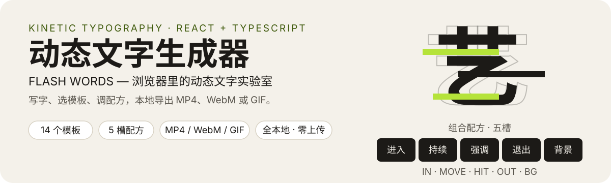
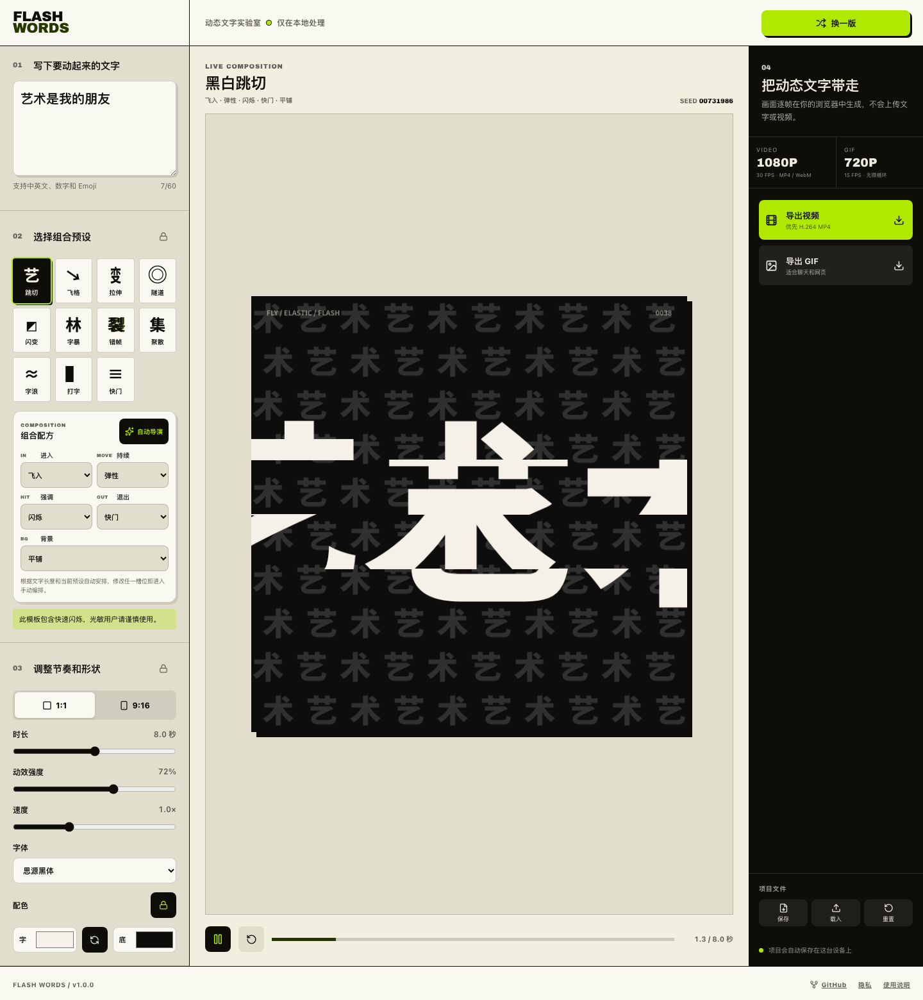

<p align="right"><a href="README.md">中文</a></p>

<p align="center">
  
</p>

<p align="center">
  <a href="https://holynova.github.io/flash-words/">▶ Try Online</a>
  ·
  <a href="https://github.com/holynova/flash-words">GitHub Repository</a>
</p>

A kinetic typography studio that runs entirely in the browser: type a line (up to 60 characters), pick a motion template, tune the five-slot recipe and pacing, preview live, and export MP4, WebM, or GIF. Rendering and export all happen locally — nothing is uploaded.

## Screenshot

<p align="center">
  
</p>

## Features

- **14 motion templates**: 黑白跳切 (Bold Cuts), 飞入网格 (Fly Grid), 平滑缩放 (Elastic Type), 无限推进 (Tunnel Zoom), 闪烁反相 (Flash Invert), 密集平铺 (Tile Storm), 故障切片 (Glitch Slice), 散落聚合 (Scatter Assemble), 波浪字流 (Wave Flow), 打字显现 (Typewriter), 快门揭示 (Shutter Reveal), 单行弹幕 (Single Marquee), 多行弹幕 (Multi Marquee), 倍增平铺 (Split Tiles).
- **Five-slot recipe**: 进入 entrance (6 options) · 持续 motion (7) · 强调 emphasis (4) · 退出 exit (6) · 背景 background (5). An auto-director picks effects from your text and pacing by default; every slot can be overridden by hand, or switch to single-effect mode (one main effect per template).
- **Pacing & shape**: duration, intensity, and speed sliders; 1:1 or 9:16 aspect; 3 fonts (思源黑体 Noto Sans SC / 思源宋体 Noto Serif SC / Archivo Black); foreground/background colors; seed-locked reproducibility.
- **Shuffle a new version**: randomize the seed and recipe to flip through variations; template, palette, and layout can each be locked so shuffling keeps them.
- **Project files**: save / load projects as JSON; the latest project autosaves locally and survives refresh.

## Export

| Format | Spec | Notes |
|---|---|---|
| Video MP4 | 1080p · 30 FPS | H.264 (AVC) preferred; falls back to WebM if the browser can't do it |
| Video WebM | 1080p · 30 FPS | Fallback when MP4 encoding is unavailable |
| GIF | 720p · 15 FPS | Encoded in a Web Worker, so the UI stays responsive |

9:16 means 1080×1920 (video) / 405×720 (GIF); export progress shows three stages (prepare, render, package) and can be cancelled midway.

## Notes

- Templates with rapid flashing may not suit photosensitive users; the UI warns about this, and the app respects the system's reduced-motion setting.
- MP4 export depends on the browser's video encoding support; when MP4 can't be produced it automatically tries WebM.

## Run Locally

Requires Node ≥ 24:

```bash
npm install
npm run dev      # dev server
npm run build    # type check + production build
npm test         # unit tests (vitest, 31 cases)
npm run test:e2e # end-to-end tests (Playwright, 21 cases)
```

## Tech

- React 19 + TypeScript + Vite; frame-by-frame Canvas 2D rendering (`src/renderer/render-frame.ts`), with the timeline split into four scenes: focus / phrase / climax / resolve.
- Video encoding via mediabunny (WebCodecs, H.264 / HEVC / VP9 by browser capability); GIF encoding via gifenc, running in a Web Worker.
- Fonts bundled locally via Fontsource: Noto Sans SC Variable (default), Noto Serif SC, Archivo Black.

```
index.html                  Entry
src/main.tsx                React entry
src/app/App.tsx             Editor UI (three columns: controls / canvas / export)
src/app/CanvasPreview.tsx   Canvas preview and playback controls
src/app/RecipeComposer.tsx  Recipe editor (five slots)
src/engine/                 Engine: templates / recipes / timeline / projects
src/renderer/render-frame.ts  Frame-by-frame Canvas rendering
src/exporters/              Export: video.ts (MP4/WebM) / gif.ts (Worker)
src/tests/                  31 unit tests + 21 e2e tests
```
