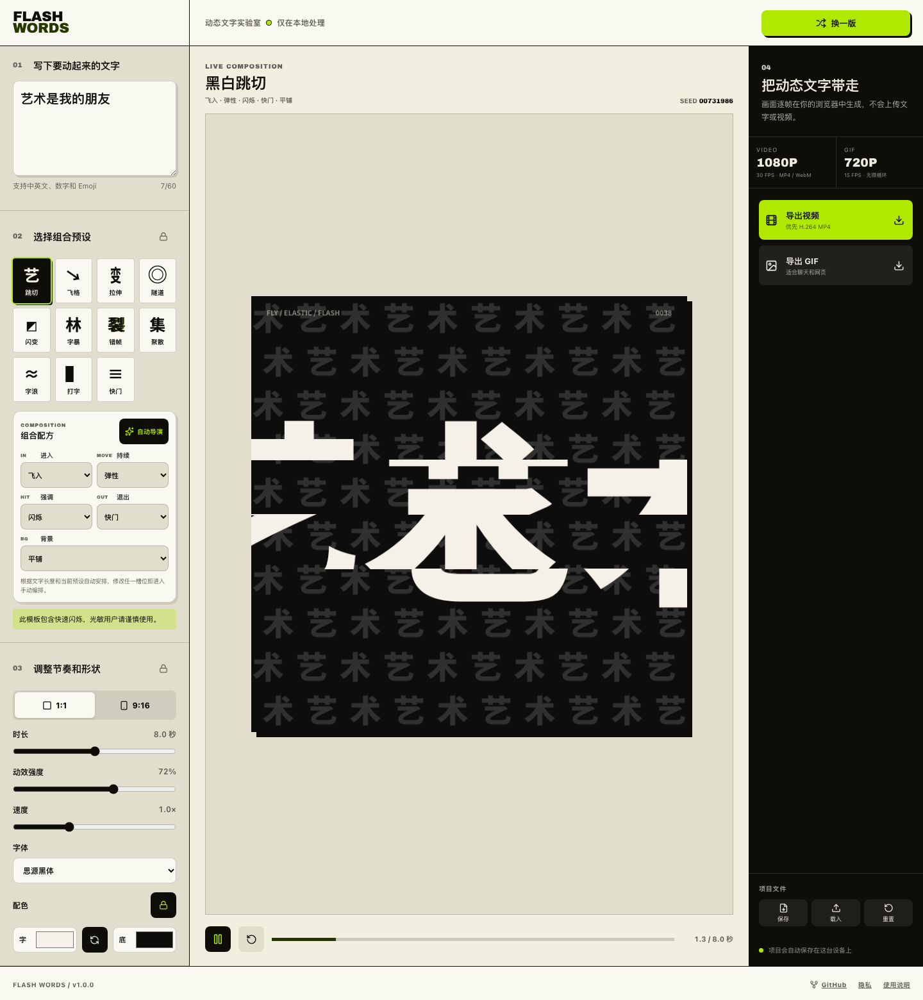

<p align="center">
  
</p>

<p align="center">
  <a href="https://holynova.github.io/flash-words/">▶ 在线使用 Try Online</a>
  ·
  <a href="https://github.com/holynova/flash-words">GitHub 仓库</a>
</p>

浏览器本地的动态文字编排工具：写一句话（最多 60 字），选一个动效模板，调一调五槽组合配方与节奏形状，实时预览后导出 MP4、WebM 或 GIF——渲染与导出全在本地完成，不上传任何文字与视频。

A kinetic typography studio that runs entirely in the browser: type a line (up to 60 characters), pick a motion template, tune the five-slot recipe and pacing, preview live, and export MP4, WebM, or GIF. Rendering and export all happen locally — nothing is uploaded.

## 截图 / Screenshots

<p align="center">
  
</p>

## 功能 / Features

- **14 个动效模板**：黑白跳切、飞入网格、平滑缩放、无限推进、闪烁反相、密集平铺、故障切片、散落聚合、波浪字流、打字显现、快门揭示、单行弹幕、多行弹幕、倍增平铺。
- **五槽组合配方**：进入（6 选）· 持续（7 选）· 强调（4 选）· 退出（6 选）· 背景（5 选），自动导演默认按文字与节奏配好动效，也可逐槽手动改；另有单效模式（每模板只用一个主效果）。
- **节奏与形状**：时长、动效强度、速度三档滑杆；画幅 1:1 / 9:16；3 种字体（思源黑体 / 思源宋体 / Archivo Black）；字色与底色自选；种子可固定复现同一版本。
- **一键换一版**：随机换种子与配方，快速刷出不同版本；模板、配色、布局可分别锁定，换版时保持不变。
- **项目文件**：保存 / 载入项目 JSON；最近一次项目自动存在本地，刷新不丢。

## 导出 / Export

| 格式 | 规格 | 说明 |
|---|---|---|
| 视频 MP4 | 1080P · 30 FPS | 优先 H.264（AVC），浏览器不支持时自动改 WebM |
| 视频 WebM | 1080P · 30 FPS | MP4 编码不可用时的兜底 |
| GIF | 720P · 15 FPS | Web Worker 里编码，不卡界面 |

9:16 画幅对应 1080×1920（视频）/ 405×720（GIF）；导出进度分准备、渲染、封装三段，可中途取消。

## 注意事项 / Notes

- 含快速闪烁的模板可能不适合光敏用户，界面有相应提示；同时遵循系统的减动效（reduced-motion）设置。
- MP4 导出能力取决于浏览器的视频编码支持；无法生成 MP4 时会自动尝试 WebM。

## 本地运行 / Run Locally

需要 Node ≥ 24：

```bash
npm install
npm run dev      # 开发服务器
npm run build    # 类型检查 + 生产构建
npm test         # 单元测试（vitest，31 个用例）
npm run test:e2e # 端到端测试（Playwright，21 个用例）
```

## 技术 / Tech

- React 19 + TypeScript + Vite；Canvas 2D 逐帧渲染（`src/renderer/render-frame.ts`），时间线分 focus / phrase / climax / resolve 四段场景。
- 视频编码用 mediabunny（WebCodecs，H.264 / HEVC / VP9 按浏览器能力选）；GIF 编码用 gifenc，跑在 Web Worker 里。
- 字体走 Fontsource 本地打包：Noto Sans SC Variable（默认）、Noto Serif SC、Archivo Black。
- 部署：GitHub Actions 构建到 `docs/`，GitHub Pages 发布。

```
index.html                  入口
src/main.tsx                React 入口
src/app/App.tsx             编辑器界面（三栏：控制 / 画布 / 导出）
src/app/CanvasPreview.tsx   画布预览与播放控制
src/app/RecipeComposer.tsx  配方编辑器（五槽）
src/engine/                 引擎：模板 / 配方 / 时间线 / 项目
src/renderer/render-frame.ts  Canvas 逐帧渲染
src/exporters/              导出：video.ts（MP4/WebM）/ gif.ts（Worker）
src/tests/                  31 个单元测试 + 21 个 e2e 测试
```

## English

**Flash Words** is a kinetic typography studio that runs entirely in the browser — no uploads, ever.

- **14 motion templates**: bold cuts, fly grid, elastic type, tunnel zoom, flash invert, tile storm, glitch slice, scatter assemble, wave flow, typewriter, shutter reveal, single/multi marquee, and split tiles.
- **Five-slot recipe**: entrance (6 options) · motion (7) · emphasis (4) · exit (6) · background (5). An auto-director picks effects from your text and pacing by default; every slot can be overridden by hand, or switch to single-effect mode.
- **Tune it**: duration, intensity, and speed sliders; 1:1 or 9:16 aspect; 3 fonts (Noto Sans SC, Noto Serif SC, Archivo Black); foreground/background colors; seed-locked reproducibility; shuffle for a new version with per-section locks (template / palette / layout).
- **Export**: video at 1080p / 30 fps (MP4 with H.264 preferred, WebM fallback) and GIF at 720p / 15 fps (encoded in a Web Worker). Projects save/load as JSON and autosave locally.
- **Run it**: needs Node ≥ 24 — `npm install && npm run dev`; tests: `npm test` (31 unit cases, vitest) and `npm run test:e2e` (21 cases, Playwright).
- **Tech**: React 19 + TypeScript + Vite; frame-by-frame Canvas 2D rendering; mediabunny for video encoding, gifenc for GIFs; fonts bundled locally via Fontsource.
